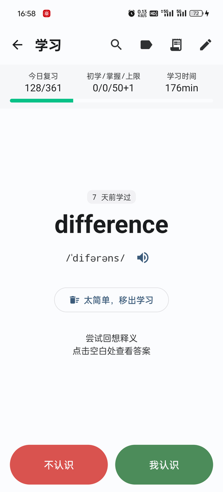

# EnglishStudying · 考研背单词

> 卡片式背单词，跑在 Android 上。SM-2 调度 + 分钟级学习步，卡片显示什么、每天学多少、按什么顺序抽词，全部可配。


**应用不内置任何词条**：词库由你自己准备，通过 CSV / JSON 导入。仓库里的 `外部资源/` 是整理考研词库时用的数据与脚本，App 本身不依赖它们。

## 截图

| 学习首页 | 词库 | 卡片 |
|:---:|:---:|:---:|
|  |  |  |

## 功能

**卡片**
- 字段可配：显示 / 隐藏、上移 / 下移、默认展开 / 折叠，附实时预览
- 正面先回忆，揭晓后再评分；评分按钮上直接印着按下之后的下次间隔
- 「模糊」进入**考到认识为止**的循环：排期当场定死，每 10 个词回来一次，直到点「认识」
- 「太简单 / 太难」是移出学习而非评分，按下后可撤销
- 每答若干张弹一次单词小结，回看这组的词形与释义

**调度**
- SM-2 + 可配置的学习步（默认 1、10 分钟）与毕业间隔
- 每日新词上限、每日复习上限（按今天已过卡的旧词数扣，不是每次会话重置）
- 新词抽取：按词频 / 入库顺序 / 随机 / 难度混合 / 按词表比例；「优先学」压过所有顺序
- 到期卡片按天对齐，学习步按分钟；两套节奏用同一个字段排序

**词库**
- 搜索（词头 / 释义 / 巧记 / 词根 / 变形）、按词表与状态筛选
- 详情页可看关联词，也能手动改下次复习时间
- **用户自定义标签**（易混、写作、听力错…）与词库自带的系统标签分开存；卡片底部可直接打标签，词库按标签筛选
- 卡片页顶部的今日进度条：深绿 = 已复习 + 掌握，浅绿 = 模糊待重考 + 初学未掌握

**关联**
- 同根词 / 变形 / 近义词三类关系独立建模，卡片上可点击跳转
- 「同一组变形的词放在一起背」：只在同类卡内部连排，新词不会被复习卡提前拉到前面

**其它**
- 真人发音（`assets/pron/`）+ 系统 TTS 回落，全程不联网
- 导入向导：列名自动识别、手动列映射、GBK / BOM / 多分隔符
- 导出今日单词为 CSV（可直接再导入）

## 快速开始

### 环境

- JDK 17 及以上（Gradle 跑在 JDK 17/21 上）
- Android SDK，`compileSdk 35`
- 构建工具链：AGP 8.7.3 + Gradle 8.9（已带 wrapper）

`local.properties` 里的 `sdk.dir` 指向本机 SDK，Android Studio 打开项目会自动生成。

### 构建

```bash
./gradlew :app:testDebugUnitTest   # 纯逻辑单测，不需要模拟器
./gradlew :app:assembleDebug       # 产物 app/build/outputs/apk/debug/app-debug.apk
./gradlew :app:installDebug        # 装到已连接设备
```

依赖仓库在 `settings.gradle.kts`：阿里云镜像优先、官方源回落。首次构建需要联网下载依赖。

### 导入词库

打开 App → 词库页右上角导入 → 选择 CSV / JSON → 确认列映射 → 导入。

```csv
word,phonetic,pos,meaning,mnemonic,root,derivation,example,tags,frequency
absent,/ˈæbsənt/,adj.,"缺席的；心不在焉的","ab(离开)+sent(存在)，人不在场→缺席","ab- 离开 + -sent- 存在","absence n. 缺席; absent-minded adj. 心不在焉的","He was absent from class. 他缺课了。",高频,90
```

完整字段表、列内容规范（变形 / 词根词缀 / 近义词怎么写才能连上关联）、导入行为见 **[docs/import-format.md](docs/import-format.md)**。示例文件：[docs/sample-vocab.csv](docs/sample-vocab.csv)。

## 文档

| 文档 | 内容 |
|---|---|
| [docs/import-format.md](docs/import-format.md) | CSV / JSON 格式、字段对照、列内容规范、导入行为 |
| [docs/scheduling.md](docs/scheduling.md) | 算法参数、学习流程、计数口径、模糊循环、手动改期、今日进度条 |
| [docs/architecture.md](docs/architecture.md) | 模块划分、技术栈、数据模型、词语关联、测试范围 |
| [docs/ui/library-redesign.html](docs/ui/library-redesign.html) | 词库界面改版设计稿（四屏，浏览器打开） |

## 已知限制

- **没有 UI 测试**：只有 `domain/` 那层是纯函数、有单测覆盖。
- **发音依赖系统 TTS 引擎**：没有录音的词走 `TextToSpeech`，国产 ROM 上可能没装引擎或没下英文语音包，此时点了没声音（静默降级，不崩）。
- **CSV 不支持反斜杠转义引号**（`\"`），请用标准的双写引号（`""`）。
- 导入结果页最多列出 100 条错误，超出只显示总数。
- 外观不可自定义（深浅色跟随系统），没有统计图表。

## 许可

仓库未声明开源许可，默认保留所有权利。如需引用其中代码，请先联系作者。
